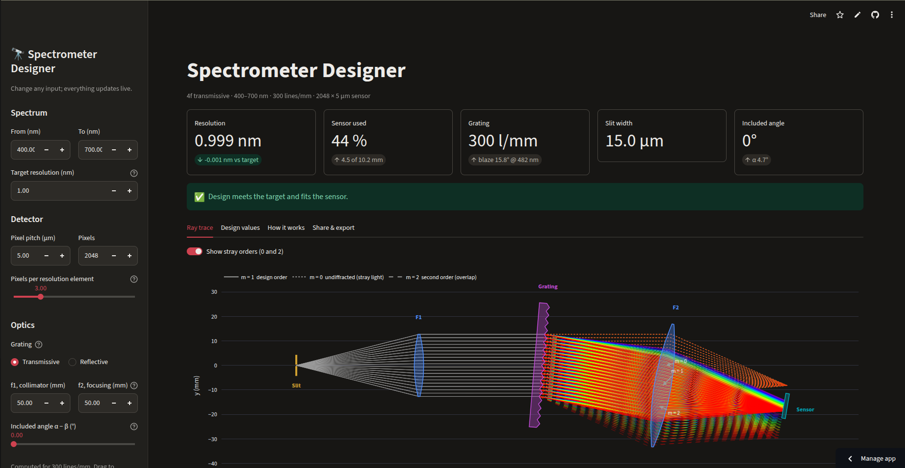

# Spectrometer Designer

Design a grating spectrometer before buying parts. Enter the wavelength range,
target resolution and detector; the app picks a grating, sizes the slit,
checks the design against the sensor and ray-traces it — all live, on one page.

**Live app:** [checkag-spectral-simulator.streamlit.app](https://checkag-spectral-simulator.streamlit.app/)

## What it does

- **Two layouts**: 4f transmissive (slit → lens → transmission grating → lens → sensor)
  and Czerny–Turner reflective (slit → mirror → reflection grating → mirror → sensor).
- **Recommends a groove density** that meets the target resolution and fits the
  sensor; the included angle is computed for you (override it with the slider).
- **Live checks with one-click fixes**: resolution, sensor overflow, order
  overlap, blaze range, mirror clearance. Each warning offers fixes such as
  "f2 = 111 mm" or "Use 2755 pixels" that are verified to clear it.
- **Interactive ray trace** (zoom, pan, hover): rays in their real colours,
  stray orders 0 and 2 on a toggle.
- **Exact mirrors** (Czerny–Turner): trace real spherical mirrors to see
  spherical aberration and coma; their blur feeds the resolution, the
  grating recommendation and the fixes (equal longer mirrors, narrower beam).
- **Detector view**: simulated pixel read-out of a calibration lamp or your
  own lines, with the grating's blaze efficiency curve.
- **Share & export**: every input lives in the URL, so a link reproduces the
  design; the full design downloads as JSON.

