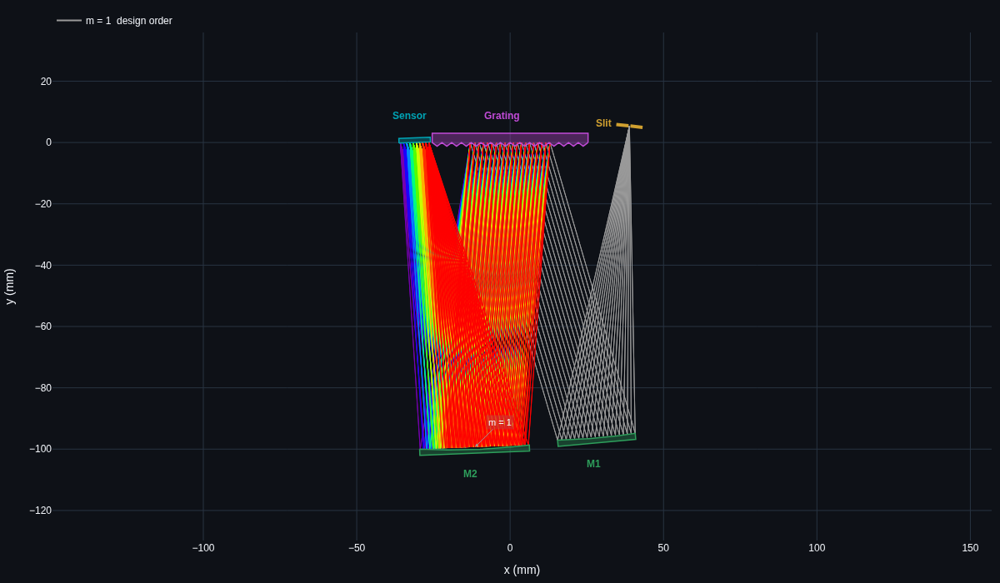

# Spectrometer Designer

Design a grating spectrometer before buying parts. Enter the wavelength range,
target resolution and detector; the app picks a grating, sizes the slit,
checks the design against the sensor and ray-traces it — all live, on one page.

**Live app:** [checkag-spectrometer-simulator-user-input-wzrswt.streamlit.app](https://checkag-spectrometer-simulator-user-input-wzrswt.streamlit.app/)


## What it does

- **Two layouts**: 4f transmissive (slit → lens → transmission grating → lens → sensor)
  and Czerny–Turner reflective (slit → mirror → reflection grating → mirror → sensor).
- **Recommends a groove density** that meets the target resolution and fits the
  sensor; the included angle is computed for you (override it with the slider).
- **Live checks with one-click fixes**: resolution, sensor overflow, order
  overlap, blaze range, mirror clearance. Each warning offers fixes such as
  "f2 = 111 mm" or "Use 2755 pixels" that are verified to clear it.
- **Interactive ray trace** (zoom, pan, hover): rays in their real colours,
  stray orders 0 and 2 on a toggle.
- **Exact mirrors** (Czerny–Turner): trace real spherical mirrors to see
  spherical aberration and coma; their blur feeds the resolution, the
  grating recommendation and the fixes (equal longer mirrors, narrower beam).
- **Detector view**: simulated pixel read-out of a calibration lamp or your
  own lines, with the grating's blaze efficiency curve.
- **Share & export**: every input lives in the URL, so a link reproduces the
  design; the full design downloads as JSON.



## Run locally

Requires Python 3.12+.

```bash
python -m venv .venv
.venv/bin/pip install -r requirements.txt
.venv/bin/streamlit run app.py
```

Or open the repo in a dev container / Codespace; it installs and starts the app.

## Tests

```bash
.venv/bin/python -m pytest
```

## Code map

| Path | Role |
|---|---|
| `app.py` | Streamlit app (single page) |
| `spectrometer/optics.py` | Physics: grating equation, dispersion, resolution, blaze, design analysis and one-click fixes, detector model |
| `spectrometer/tracer.py` | Vectorised 2-D ray tracer: ideal lenses/mirrors, exact spherical mirror, grating, sensor |
| `spectrometer/layout.py` | Builds the 4f / Czerny–Turner layouts from a design, traces them, measures mirror blur |
| `spectrometer/plot.py` | Plotly figures: ray trace, detector read-out, blaze efficiency |
| `spectrometer/config.py` | Defaults and limits |
| `notebooks/walkthrough.ipynb` | The design calculations step by step |
| `tests/` | `pytest` suite (physics, tracer, traced layouts vs analytic) |
