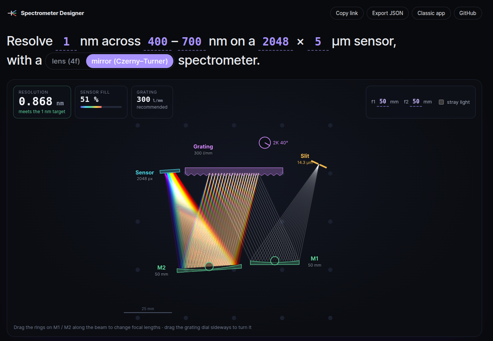

# Spectrometer Designer

Design a grating spectrometer before buying parts. Enter the wavelength range,
target resolution and detector; the designer picks a grating, sizes the slit,
checks the design against the sensor and ray-traces it — all live.

It comes in two flavours that share the same physics and the same shareable
links, so a design opened in one can be carried over to the other.

| | **Interactive bench** | **Classic app** |
|---|---|---|
| Open | [checkag.github.io/Spectrometer-simulator](https://checkag.github.io/Spectrometer-simulator/) | [checkag-spectral-simulator.streamlit.app](https://checkag-spectral-simulator.streamlit.app/) |
| Style | Drag the optics on an optical bench; animated explainers | Form, tabs and charts |
| Runs | Entirely in your browser (no server, never sleeps) | Python on Streamlit Community Cloud |

## Interactive bench



- **Say what you need in one sentence** — "Resolve 1 nm across 400–700 nm on a
  2048 × 5 µm sensor, with a mirror spectrometer" — every number is editable in place.
- **Edit by touching the hardware**: drag the collimator or focusing optic along its
  beam to change the focal length, turn the dial on the grating to change its angle.
  Light is drawn additively in its real colours on a 25 mm breadboard.
- **Problems glow on the part that causes them**, with one-click fixes in the
  diagnostics panel.
- **What the sensor sees**: the simulated read-out of a calibration lamp, the sodium
  doublet or your own lines, rendered as a spectrum strip, with a resolved /
  not-resolved verdict for close pairs.
- **Datasheet** of the finished design, copy-link and JSON export.
- **How a spectrometer works**: five short animated films — the journey of light,
  wavelets inside the grating, resolution, blaze, order overlap — with sliders that
  change the physics as they play.

## Classic app


- **Two layouts**: 4f transmissive (slit → lens → transmission grating → lens → sensor)
  and Czerny–Turner reflective (slit → mirror → reflection grating → mirror → sensor).
- **Recommends a groove density** that meets the target and fits the sensor; the
  included angle is computed for you (override it with the slider).
- **Live checks with one-click fixes**: resolution, sensor overflow, order overlap,
  blaze range, mirror clearance — each fix (e.g. "f2 = 111 mm", "Use 2755 pixels")
  is verified to clear its warning.
- **Interactive ray trace** with stray orders 0 and 2, **exact spherical mirrors**
  (aberrations feed the resolution and the fixes), a **detector view** and the blaze
  efficiency curve.
- **Share & export**: every input lives in the URL; the design downloads as JSON.


## The physics

Both apps use one model: the grating equation *mλG = sin α + sin β* with the layout
fixed by the included angle, tilted-focal-plane dispersion, slit-image and
grating-limited resolution, a scalar blaze-efficiency model, and a vectorised 2-D
ray tracer with ideal lenses and exact spherical mirrors. The Python package
(`spectrometer/`) is the reference; the browser version is a TypeScript port that is
tested against reference outputs generated from it.

<details>
<summary><b>For developers</b></summary>

### Layout

| Path | Role |
|---|---|
| `spectrometer/` | Python physics core (reference): `optics.py` design and fixes, `tracer.py` ray tracer, `layout.py` 4f / Czerny–Turner layouts, `plot.py` Plotly figures |
| `app.py` | Classic Streamlit app |
| `web/` | Interactive bench: Vite + React + TypeScript; physics port in `web/src/physics/` |
| `web/scripts/make_fixtures.py` | Writes reference outputs from the Python core for the TypeScript tests |
| `notebooks/walkthrough.ipynb` | The design calculations step by step |
| `tests/` | `pytest` suite |

### Run

```bash
# Classic app (Python 3.12+)
python -m venv .venv && .venv/bin/pip install -r requirements.txt
.venv/bin/streamlit run app.py
.venv/bin/python -m pytest

# Interactive bench (Node 22)
cd web && npm ci
npm run dev        # local dev server
npm test           # TypeScript physics vs. Python fixtures
npm run fixtures   # regenerate fixtures after changing the Python core
```

### Deployment

- **Classic app**: Streamlit Community Cloud runs `app.py` from `master` (Python 3.13).
  After a merge that adds new names to a module, reboot it from *Manage app*.
- **Interactive bench**: `.github/workflows/web.yml` runs the Python tests, regenerates
  the fixtures from the Python core, runs the web tests against them and builds, and on `master` deploys
  `web/dist` to GitHub Pages.

</details>
